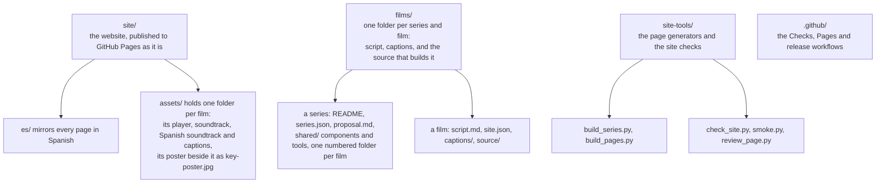

# learning-data

Learning artifacts for data: short, visual explanations of how modern data platforms work, from capture to decision.

**Site:** [https://data.learn-all.org/](https://data.learn-all.org/)

## The films

<!-- topics: made by site-tools/build_series.py from the topics and each module's module.json -->
The site has twelve big topics. Start with the first, the overview; then pick the topic you need, in any order. Each topic holds films and series.

| Topic | What it covers | Films and series | For |
|---|---|---|---|
| Data platforms | How data moves through a modern data platform, from a tap on a phone to a decision. | [The Inner Life of Data](https://data.learn-all.org/) | Start here: for everyone |
| Data modelling | What the numbers mean, and the shapes that hold them: words and definitions first, then models, before any system. | [A Sharper Sketch](https://data.learn-all.org/sketch/), [From words to data](https://data.learn-all.org/from-words-to-data/) | For anyone who designs models, definitions or reports |
| Modern data basics | What today's tools make easier: moving data, running it as software, serving it to people and agents, and reading documents. The architecture only: the official docs go deeper. | [Data that moves](https://data.learn-all.org/data-that-moves/), [Data as software](https://data.learn-all.org/data-as-software/), [From tables to decisions](https://data.learn-all.org/from-tables-to-decisions/), [Documents and closing remarks](https://data.learn-all.org/documents-as-data/) | For anyone who moves, runs or serves data, and anyone choosing the tools |
| Analytics engineering | How an agreed data model becomes tested, documented tables, with dbt. | [In the weeds of data crafting](https://data.learn-all.org/in-the-weeds/) | For analytics engineers |
| Data quality | What good enough means for data, what goes wrong, and what catches it: changes, contracts, checks, and errors fixed where they start. | [When things go wrong](https://data.learn-all.org/when-things-go-wrong/), [Fit for use](https://data.learn-all.org/fit-for-use/), [Quality as a habit](https://data.learn-all.org/quality-as-a-habit/) | For anyone who builds pipelines, owns a source system or a data product, or depends on data being right |
| Enterprise architecture | How an organisation works, in layers, before you ask what its data should answer. | [The map before the data](https://data.learn-all.org/enterprise-architecture/), [Business architecture for data](https://data.learn-all.org/business-architecture-for-data/), [Data architecture](https://data.learn-all.org/data-architecture/), [AI and continuous architecture](https://data.learn-all.org/ai-and-continuous-architecture/) | For architects, and anyone new to an organisation |
| Master and reference data | The people and things a business is about, kept once and shared across its systems, and the lists that sort them. | [The same one, everywhere](https://data.learn-all.org/master-and-reference-data/) | For data stewards and architects, and anyone whose data lives in many systems |
| Data governance | Who decides what, and how each decision reaches the work: policies that run as checks, owners and tests, not on a shelf. | [Governance principles](https://data.learn-all.org/data-governance/), [Governance on the map](https://data.learn-all.org/governance-on-the-map/), [Governance you can use](https://data.learn-all.org/governance-in-practice/) | For governance teams and data owners, and anyone asked to make the rules work |
| Data protection and privacy | Who and what may reach the data, what each person may see, and how long personal data is kept: each lock built from a role, a boundary or a rule already decided. | [Locks before the data](https://data.learn-all.org/locks-before-the-data/), [Only what you may see](https://data.learn-all.org/only-what-you-may-see/), [Kept for a reason](https://data.learn-all.org/kept-for-a-reason/) | For platform teams, data owners and anyone who gives or gets access to data |
| AI agents in data work | Agentic data engineering from the ground up: what an AI agent is and how we got here, what agents are like to work with, and why that means governing them. | [What an agent is](https://data.learn-all.org/what-an-agent-is/), [Agents at work on data](https://data.learn-all.org/agents-at-work-on-data/), [From helper to colleague](https://data.learn-all.org/from-helper-to-colleague/) | For everyone who works with data, and will work beside an AI agent |
| Leading data people | The skills data work needs now, and leading the people who do it: seeing the whole, working beside agents, listening, explaining, saying no well, leading a team, owning an outcome, and growing people. | [The new skills](https://data.learn-all.org/the-new-skills/), [Working with people](https://data.learn-all.org/working-with-people/), [Leading a data team](https://data.learn-all.org/leading-a-data-team/), [Ownership and performance](https://data.learn-all.org/ownership-and-performance/) | For anyone who works in data, and anyone who leads the people who do |
| Data management | A data manager's whole job: every area in one picture, a plan in stages, a case and its risks, everyone at the table, and small steps, measured. | [A plan in ninety days](https://data.learn-all.org/a-plan-in-ninety-days/), [Making the case](https://data.learn-all.org/making-the-case/), [Architecture that keeps up](https://data.learn-all.org/architecture-that-keeps-up/), [Small steps, measured](https://data.learn-all.org/small-steps-measured/) | For data managers, and anyone who leads data work across an organisation |
<!-- /topics -->

Every film has chapters, Pause and think questions and Spanish pages; most have hands-on labs and scenarios too.

And on the [Making of page](https://data.learn-all.org/journey/), two short films about the films themselves: *Data for Films*, how they're drawn, and *That's not quite right*, how they're made, by a person and Claude.

## What's here

- The pages of the series, the Topics page, the *Decided* tables and the legibility report are generated (see *Each film keeps its own rows* below): never edit them by hand.
- Internal names never appear as text on the site. The numbers in the series' folder names only keep the folders in order; the release workflow and the site's links to GitHub use them, so don't rename the folders.
- `site/films/` holds only redirects (`films/` goes to `topics/`), and `site/assets/film3/` is A Sharper Sketch's player folder: historical names the release workflow and the site's links use, so don't rename them.
- The example dbt project the analytics-engineering films draw from lives at `films/analytics-engineering/project/` and is checked by its own workflow, `credential-project.yml`.
- For more detail, read the README closest to what you touch — a series' `films/<series>/README.md` or a film's `films/<series>/<n>-<film>/source/README.md` (the build guide is [The Inner Life of Data's](films/inner-life-of-data/source/README.md)) — and [CONTRIBUTING.md](CONTRIBUTING.md) for how to work here.

## How the site is organised

- **Header, the same on every page:** *Start here · Topics · Making of*, then *EN/ES*, and icon links to learn-all.org and to the author on LinkedIn; every link stays visible on phones. It is made in one place, `header()` in `site-tools/build_series.py`, for every page: the series' pages, the hand-written pages listed in `HAND_PAGES` (it writes over their header) and the Markdown pages. Change it there and run `build_series.py` and `build_pages.py`, never on a page. The footer's one link is the source on GitHub. The header never lists a film's own steps. The Topics link is marked as current on every page under a topic.
- **Topics:** twelve big topics, set in `TOPICS` in `site-tools/build_series.py`, each holding films and series: *Data platforms* (the overview, where everyone starts), *Data modelling*, *Modern data basics*, *Analytics engineering*, *Data quality*, *Enterprise architecture*, *Master and reference data*, *Data governance*, *Data protection and privacy*, *AI agents in data work*, *Leading data people* and *Data management*. The Topics page has a section per topic, with who it's for and a card per film or series (a series' card counts how many of its films were watched); the home page shows the topics after the first as tiles, each listing its films and series, and so does the end of the intro's scenarios.
- **Stepper, on a film's own pages:** the film's steps, such as *Watch · Take it apart · Make the call*, as an `ol.path` under the title. Only a film with labs or scenarios has one; Silent change has none yet, and Too good to be true has one.
- **Breadcrumbs:** every film, labs, scenarios and series page starts with one that names its topic, such as *Topics › Data modelling › From words to data*; the topic links to its section of the Topics page.
- **Guidance after a film:** a "Where next?" panel when the film ends (`next.js` shows the page's `<template id="next-panel">`), "Go deeper" on the home page and at the end of the scenarios of *The Inner Life of Data*, and "Go further" on each topic's page.
- **No film numbers.** Each film is shown by its topic, then its title. Only a series numbers its films, always as *Film 2 of 7*; the film of a series of one says *A single film*.
- **Drafts:** content its author hasn't reviewed yet says so. A series whose `series.json` has `"draft": true` shows *Draft · The author hasn't reviewed it yet, so some details may change* (*Borrador* in Spanish) under the title of its page and each of its films' pages. A film's own `site.json` can say `"draft": false` once its author has reviewed it, or `"draft": true` on its own.
- **English and Spanish:** English pages sit at the root and Spanish ones under `es/`, at the same paths. Every page has an EN/ES toggle to the same page in the other language; A Sharper Sketch's labs and scenarios, which are in English only, toggle to `es/sketch/`. Spanish pages have Spanish chapter names, controls and captions. When a film has `site/assets/<key>/soundtrack.es.mp3`, its Spanish page also uses that soundtrack; the pictures stay in English, and the English page keeps `soundtrack.mp3`. Other films keep their English narration on the Spanish page. Links from Spanish pages to English pages say "(en inglés)".

**Progress** stays in the visitor's browser (local storage), under one prefix per film:

| Prefix | Film | Keys |
|---|---|---|
| `ld:` | The Inner Life of Data | `watched`, `visited`, `stop`, `quiz`, and `think` (the "Pause and think" setting, shared by every film) |
| `ld3:` | A Sharper Sketch | `watched`, `visited`, `quiz`. A historical name: never rename it, or visitors lose their progress. |
| `ld-silent-change:` | Silent change | `watched` |
| `ld-too-good-to-be-true:` | Too good to be true | `watched`, `visited` (labs), `quiz` (scenarios) |
| `ld-<film>:` | Each film of a series made by `build_series.py`, such as `ld-whats-in-a-word:` | `watched`, and `visited` (labs) and `quiz` (scenarios) for a film that has them |
| `ld-<series>:` | A series with one set of labs and scenarios for all its films, such as `ld-enterprise-architecture:` | `visited` (labs) and `quiz` (scenarios, numbered by film and place, such as `31`); each film keeps `watched` under its own prefix |

A film's page sets its prefix with `data-store` on `section#watch`, and `path.js` marks the film as watched once 85% of its length has actually played (seconds of playback, so a seek or one late chapter doesn't count). A page without `data-store` records nothing, so one film's page never marks another film as watched. Topic cards show each film's progress from `data-progress="<prefix>"`, and a series' card how many of its films were watched, from `data-films="<prefix> <prefix> …"`. The Sketch pages don't load `path.js`: `sketch.js` paints their stepper, records `ld3:watched` by the same rule, and fills the topic cards' progress there.

## Publishing

1. **Turn on GitHub Pages (once):** Settings → Pages → Build and deployment → Source: *GitHub Actions*. A push to `main` publishes `site/` after its *Checks* workflow succeeds; deployment restores and verifies declared audio first. You can also run it by hand from the Actions tab (*Publish site* → *Run workflow*).
2. **Release the videos:** in the Actions tab, open *Render and release the films* → *Run workflow*, and give a tag such as `v2.0`, and which films to render: `changed` (the default: only the films whose source, or the shared code they draw with, changed since the latest release), `all`, or a list of keys such as `silent-change-en,too-good-to-be-true-en`. It renders them from the committed source at the same time, in about 30 to 45 minutes for all of them, and publishes `inner-life-of-data.mp4`, `inner-life-of-data.es.mp4`, `a-sharper-sketch.mp4`, `silent-change.mp4`, `too-good-to-be-true.mp4`, the Making of films `data-for-films.mp4` and `thats-not-quite-right.mp4`, the seven films of *From words to data* (such as `whats-in-a-word.mp4`), the films of *In the weeds of data crafting* (such as `declare-it-then-build-it.mp4`), of *The map before the data* (such as `day-one.mp4`), of *The same one, everywhere* (such as `one-person-many-roles.mp4`) and of *Governance you can use* (such as `off-the-shelf.mp4`), and their captions to a release with that tag. The videos have no captions on the picture: each comes with `.srt` files beside it, in English, and in Spanish for *The Inner Life of Data* and every film with Spanish captions. Before rendering, it checks that each film's player on the site is byte for byte the one its source builds. The videos it doesn't render are copied from the latest release, so every release carries every film, and the site's download buttons, which point to the latest release, work as soon as it's published. The run's summary lists which films changed, which were rendered and which were carried over, and warns about a film that changed but wasn't rendered. Tick *draft* to watch the videos before they go live. Keeping videos out of the repository keeps clones small. To render on your own computer instead, see each film's `source/README.md`, starting with [the build guide of *The Inner Life of Data*](films/inner-life-of-data/source/README.md).

## The labs and scenarios

*The Inner Life of Data* has three pages: *Watch* (the home page), *Take it apart* (`labs/`) and *Make the call* (`scenarios/`). *Take it apart* has eight stops, one per chapter of the film, each with a hands-on lab, and each stop has its own link, such as `labs/#refine`. Its "Watch this part" buttons play that chapter in a pop-up player. *Make the call* has twelve scenarios in four formats: choose, sort, order and spot the row, and each one links back to its lab. Both draw with the film's own components (vaults, data tiles, the sketch, paintings, Genie), which `assets/film/film.js` provides, and both take their words from `assets/learn/learn.en.js` and `learn.es.js`. To change a text, edit both language files and keep their keys the same. To add a scenario, add it to `quiz.qs` in both files; `vis` picks one of the small scenes in `quiz.js`.

*From words to data* has one engine for all seven films, `assets/from-words-to-data/learn.js`: each lab is one of five kinds (sort, count, pick, compose, steps) described entirely by its words, in each film's `learn.en.js` and `learn.es.js`, with a picture drawn by the film's own code (its `LV`). See [the series' README](films/from-words-to-data/README.md).

*The map before the data* has one set for the whole series instead, on its own two pages (`enterprise-architecture/labs/` and `scenarios/`): twelve labs, one for each film and one on ArchiMate 4, and 25 scenarios, each naming its film. Its engine, `assets/enterprise-architecture/learn.js`, has seven kinds of lab, each described by its words in `learn.en.js` and `learn.es.js`, and draws with the series' own components; each film's Pause and think questions open its lab. A series gets this with `learn` in its entry in `SERIES` in `site-tools/build_series.py`, and `smoke.py` plays its labs through with a script in `site-tools/smoke/`. See [the series' README](films/enterprise-architecture/README.md#labs-and-scenarios).

*A Sharper Sketch* follows the same shape with six labs and twelve scenarios, all in `assets/sketch/sketch.js`; see [its README](films/a-sharper-sketch/README.md). *Too good to be true* has three labs and ten scenarios in `assets/too-good-to-be-true/learn.js`, with their words in `learn.en.js` and `learn.es.js`, so both languages share one engine; its Pause and think questions link to its own labs. Old links to the one-page version of the home page (`#explore`, `#practise`) redirect to the labs and scenarios pages.

## Contributing

The [portal-to-source catalog](modules/README.md) maps modules and series to their film folders and learning content. [Maintenance and audio storage](docs/maintenance.md) explains scoped checks and the migration of soundtracks out of Git.

[CONTRIBUTING.md](CONTRIBUTING.md) is the practical guide: what to install, how to make a change, and how to check it — only the checks a change needs, never the whole site or every film. [PLAYBOOK.md](PLAYBOOK.md) collects what made the films work, from the two-audience promise to pacing, rigour and the labs, with checklists for the script, the render and the release, for the next film or course. [AGENTS.md](AGENTS.md) is the process every film change follows.

## Each film keeps its own rows

Every film has a row in a few lists, and two films that edit the same list at once clash when they merge. So each film keeps its rows in its own folder, and `python site-tools/build_series.py` makes the lists from them; `site-tools/check_site.py` fails if a list isn't what it makes. Never edit these lists by hand:

| The list | Made from |
|---|---|
| The release workflow's films, and its notes (`.github/scripts/films.py` gathers them when it runs) | each film's `release.json`, and each series' `release-note.md` |
| A series' films, on its pages and in its README | its numbered folders (`<n>-<film>/source/film.json`), not a list in `series.json` |
| A series page's *Every film opens somewhere else* rows | each film's `site.json` (`past`, `past_es`) |
| A series' *Decided* table, in its `proposal.md` | the series' `decided.md`, and each film's `decided.md` (a decision a film's thread makes, even for the whole series, goes in the film's file) |
| The films in `films/legibility-report.md` (not committed: `build_series.py --legibility` prints it, and each publish of the site shows it in its summary) | `legibility` in each film's `release.json` |
| The table of topics under *The films*, above | the topics in `build_series.py`, their series, and each module's `module.json` (`who`) |
| The series pages, Topics and the home page's series cards | all of the above, through `build_series.py` |
| Each series' count of films on the home and Scenarios pages' topic tiles (not committed: `build_series.py --publish` fills it in when the site is published) | each series' numbered folders |

When two branches clash in one of these lists or pages, take either side, merge the rows in the films' own files, and run `python site-tools/build_series.py` again.

## Licence

- **Code:** MIT, see [LICENSE](LICENSE).
- **Film, script, captions, images and text:** CC BY 4.0, see [LICENSE-CONTENT.md](LICENSE-CONTENT.md).
- **Not covered:** company logos and trademarks, including the Databricks and dbt logos, which belong to their owners. See [NOTICE.md](NOTICE.md).
