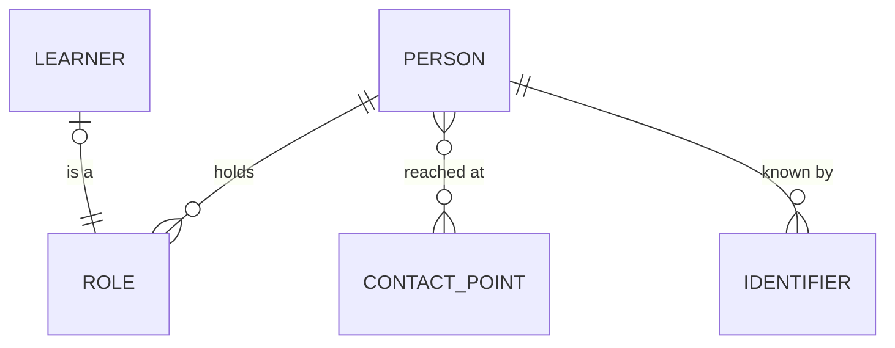

# Person domain: conceptual model

The person behind every role the university records, the roles they hold, how to reach them, and
the numbers each system knows them by. Drawn by hand, for people. The learner belongs to the
student domain, and is shown here because it's a role a person holds. Where this domain sits among
the university's other domains: [the university's map](../../_shared/_shared__conceptual.md).

How to read it:

- A person holds many roles, at once or one after another: applicant, student, tutor, researcher,
  alumni. Each role has its own dates and its own owner.
- A person is reached at contact points, each for a purpose. One contact point, such as a shared
  home address, can reach more than one person.
- A person is known by every number a system gave them. None replaces another.
- The student domain's learner is a role: a person, learning with the university.

Each entity's definition, business key, identity rules and owner are written once, in
[`_person__conceptual.yml`](_person__conceptual.yml). The doc blocks are generated from it
([`_person__definitions.md`](_person__definitions.md)). It's a draft, and no core model reads it
yet: what's still open is in
[`requirements/models/person/`](../../../requirements/models/person/_person__requirements.yml).
