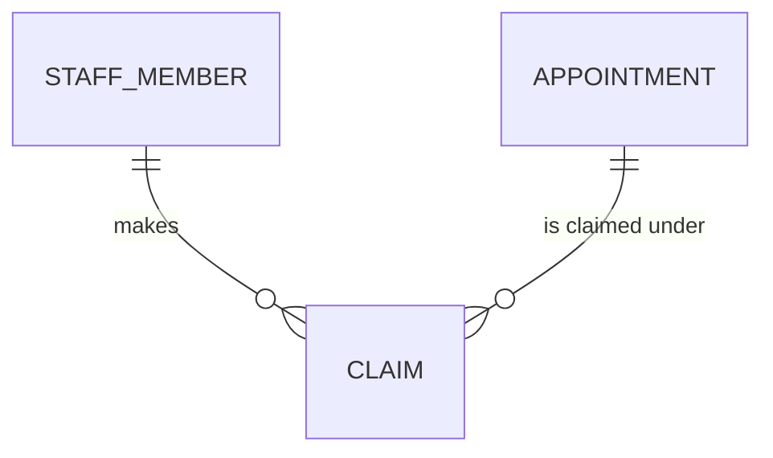

# Staff domain: conceptual model

The university's staff and the work they're paid for. Drawn by hand, for people. Only the claim is
modelled so far; the staff member and the appointment (a contract of employment) are on
[the university's map](../../_shared/_shared__conceptual.md), planned, and the claim reads its
contract from the HR system's data.

How to read it:

- A casual staff member claims the hours they worked, one claim for each unit, duty and day.
- Each claim is made under one contract, for one teaching period; the contract gives its pay type.
- The unit's coordinator approves a claim or returns it. An approved claim is paid on a pay day:
  the first whose claims close at or after its approval.

The definition is written once, in [`_staff__conceptual.yml`](_staff__conceptual.yml), and shown
through [`_staff__definitions.md`](_staff__definitions.md). The physical model is generated
([`_staff__physical.md`](_staff__physical.md)).
