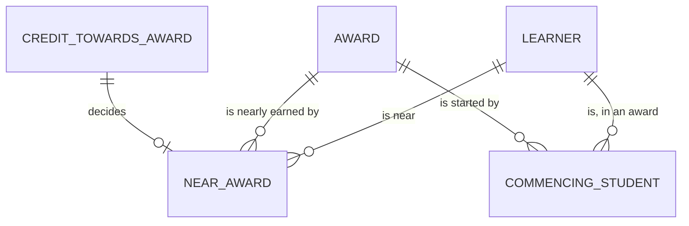

# Planning: conceptual model

What Planning sees: a learner near an award, and a commencing student, as at census date. Drawn
by hand, for people. It uses the core's entities as they were on the census date, and adds two
concepts of its own.

How to read it:

- A learner is near an award when, on the census date, they were studying, enrolled in it, and
  had more than none and no more than 15 credit points left to earn towards it.
- Planning counts them by faculty. The rule and the count are written once, in
  `macros/planning/near_award.sql`, and the semantic layer's metric is the same count.
- A learner is a commencing student in an award when they started it at the university for the
  first time in the census date's year; one coming back after leave or a break isn't. The meaning
  is the business glossary's term, copied with where it came from, and the rule is written once,
  in `macros/planning/commencing.sql`.

The question, the decision it supports and the concepts are written once, in
[`_planning__conceptual.yml`](_planning__conceptual.yml). The learner, the award and credit
towards an award are the core's ([student](../../core/student/_student__conceptual.yml),
[course](../../core/course/_course__conceptual.yml)).
