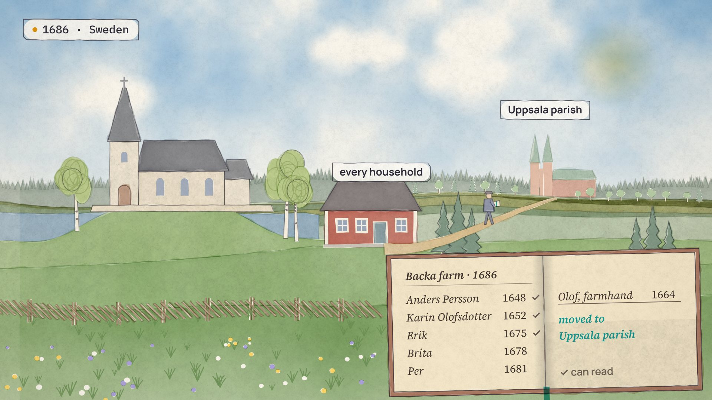
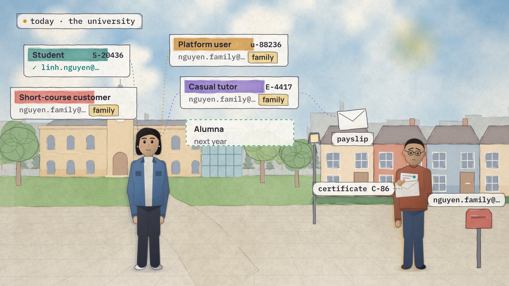
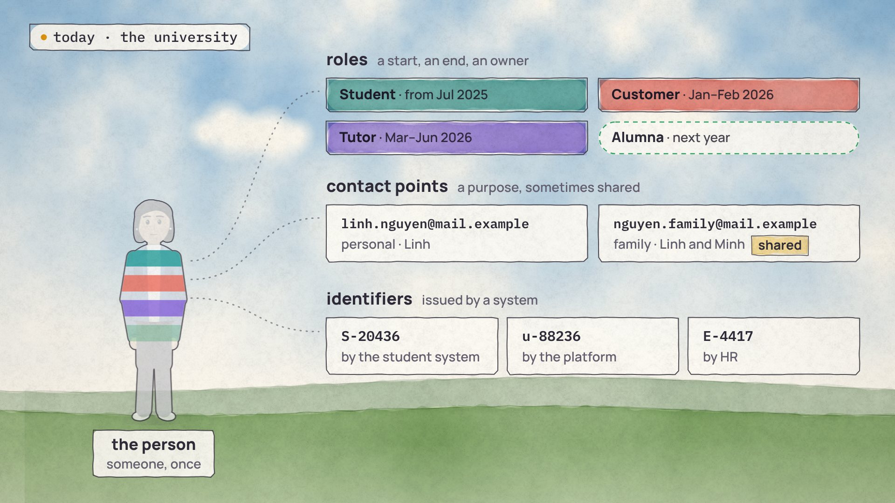

# The look: watercolour

Chosen on 16 October 2026 from seven looks, for every film in the series. Drawn from three moments of [*One person, many roles*](../1-one-person-many-roles/script.md); they show the look, not final layouts.

**1686 parish** (chapter 1): the past in the same watercolour; the parish book in parchment and ink.

**Campus today** (chapter 3): each system's card wears its role's colour as a brushstroke; people in pencil and wash.

**Four lanes** (chapter 6): the person cleared to white paper, banded in her roles' colours, the strongest washes on screen.

